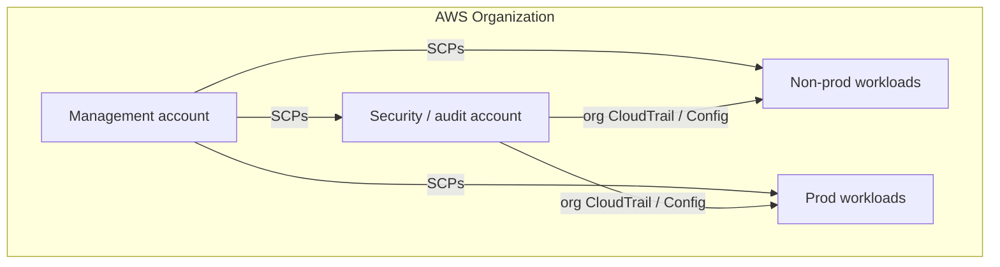
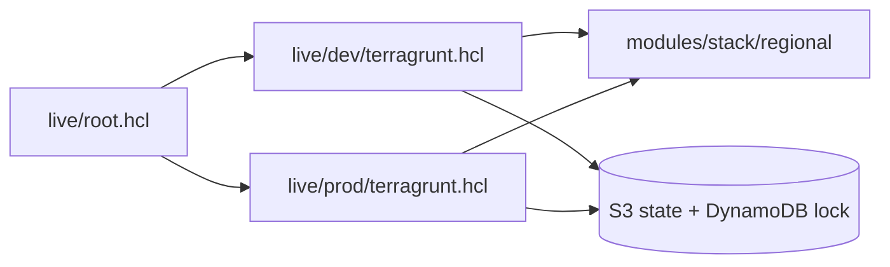
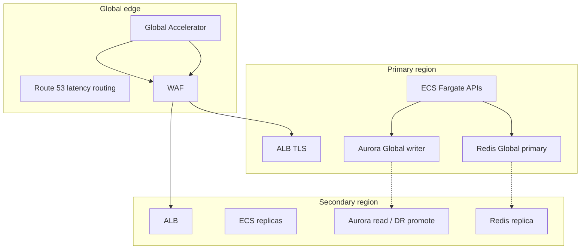
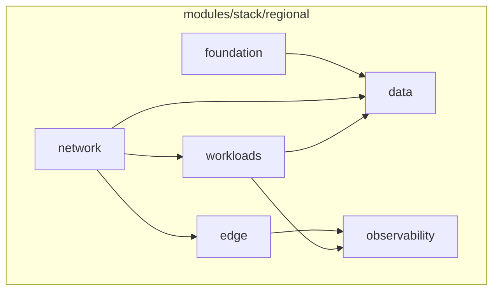

# Problem 1 — Spot trading platform architecture

Reference capability: institutional spot trading ([Binance-class UX](https://www.binance.com/en/trade)). The narrative below covers the **target platform**; runnable IaC is under [terraform/](terraform/) (Terragrunt + modules).

## Spot trading features (in scope)

| UI / capability | Role |
| --- | --- |
| SPA shell | Loads trading experience in the browser |
| Market summary | Price, 24h change, high, low, volume |
| Watchlist | Multi-pair price updates |
| Order book | Live bids and asks |
| Chart | Historical and live OHLCV |
| Order entry | Place and cancel limit / market orders |
| Recent trades | Public trade tape |
| Order history | User orders and fills |

**Out of scope for this repo:** futures, margin, staking, bots, fiat rails, KYC, on-chain custody, full matching-engine implementation.

## Workload assumptions (500 RPS design point)

| Assumption | Value |
| --- | --- |
| Peak HTTP at edge | 500 RPS sustained |
| Sync HTTP p99 | &lt; 100 ms in-region |
| Concurrent WebSockets (target) | 10k connections; live book/ticker fan-out |
| Order path | Accept → durable write → async match/settle (target) |

| HTTP class | RPS (peak) | Examples |
| --- | ---: | --- |
| Public reads | 180 | Summary, watchlist, chart, book snapshot |
| Trading writes | 125 | Place / cancel orders |
| Private reads | 75 | Balances, open orders, history |
| Auth / metadata | 70 | Login, refresh, rules |
| WebSocket connect / reconnect | 50 | Live market streams |
| **Total** | **500** | |

Headroom for load tests: design for **5×** average before horizontal scale limits ([Quality attributes](#quality-attributes)).

## Rough monthly cost (single region, illustrative estimate)

Assumes **ap-southeast-1**-class pricing, 730 h/month, ~30% of peak RPS on average, no tax or Enterprise Support. Aligns with **Aurora + ECS + Redis** target (not a third-party exchange fee model).

| Item | Spec (illustrative) | USD / month |
| --- | --- | ---: |
| ECS Fargate (Graviton) | API + worker tasks across 3 AZ | 350–550 |
| Aurora PostgreSQL | Multi-AZ, PITR | 400–900 |
| ElastiCache Redis | 3-AZ replica set | 70–180 |
| ALB + NAT + data transfer | HTTPS + egress | 200–600 |
| CloudFront + S3 (SPA + audit) | Static UI + logs | 50–150 |
| CloudWatch + optional Slack | Metrics, logs, alarms | 80–200 |
| KMS + Secrets Manager | Keys and app secrets | 5–20 |
| **Indicative total** | Target architecture | **1.2k–2.6k** |

FinOps in repo: mandatory `CostCenter` tags via Terragrunt ([live/root.hcl](terraform/live/root.hcl)). Global multi-region and MSK-scale designs would increase this; see [Target vs this repository](#target-vs-this-repository).

## Quality attributes

| Attribute | Target | Mechanism |
| --- | --- | --- |
| Availability | 99.95%+ regional | Multi-AZ, Aurora Global DB, Redis Global Datastore, health-based routing |
| Latency | p99 &lt; 100 ms in-region | Edge caching, colocated AZs, RDS Proxy, minimal sync chain |
| Throughput | 500 RPS (5× headroom) | Horizontal ECS, partition-ready order path |
| DR | RPO minutes, RTO &lt; 1 h | Cross-region read failover; rehearsed Aurora promote |
| Cost elasticity | Scale down off-peak | Scheduled scaling, Graviton, tiered cache |
| Change safety | Zero-downtime deploy | Blue/green (CodeDeploy), feature flags, IaC promotion by tag |

## Landing zone (target)

- SCPs: deny public S3, unapproved regions, unrestricted IAM wildcards.
- Workload accounts host the regional stack; foundation module supplies KMS, audit bucket, CloudTrail, GuardDuty.

## Terragrunt and state

- Remote state: S3 + DynamoDB (`live/root.hcl`).
- Mandatory tags: `CostCenter`, `Environment`, `Service`, `Owner`, `ManagedBy`, `Project`.
- Engine and instance sizes: Terragrunt inputs only ([live/dev](terraform/live/dev/terragrunt.hcl), [live/prod](terraform/live/prod/terragrunt.hcl)).

Toolchain pins: [docs/VERSION-PINS.md](../../docs/VERSION-PINS.md).

## Multi-region (target)

Latency routing sends users to the nearest healthy region. Loss of a region shifts traffic; the write path may consolidate to the primary until DR runbook completion. Data: Aurora Global + Redis Global Datastore; async settlement via MSK/SQS (target).

## Regional stack (implemented in repo)

| Module | Role |
| --- | --- |
| [foundation](terraform/modules/foundation/) | KMS, audit S3, CloudTrail, GuardDuty |
| [network](terraform/modules/network/) | VPC 5.21.x module, NAT, subnets |
| [workloads](terraform/modules/workloads/) | App security groups, ECS-ready |
| [data](terraform/modules/data/) | RDS PostgreSQL, ElastiCache Redis |
| [edge](terraform/modules/edge/) | Public ALB, WAF (prod) |
| [observability](terraform/modules/observability/) | CloudWatch → SNS → Slack (optional) |

## Scale and FinOps

- **Scale up:** ECS on CPU / ALB latency; Aurora replicas / ACU; Redis shards.
- **Scale down:** Lower min capacity off-peak; order API never zero in prod.
- **FinOps:** `CostCenter` tag for chargeback; Savings Plans on baseline compute.

## Backup and release

- Aurora PITR (35d prod); Redis snapshots; S3 state versioning.
- App blue/green via new ECS task set; rollback on alarm breach.
- IaC promotion: dev → prod with git tag on module source ([terraform/README.md](terraform/README.md)).

## Target vs this repository

| Target | Repository today |
| --- | --- |
| Multi-account org + SCPs | Documented; modules assume one workload account |
| Multi-region + GA + Aurora Global | Single **regional stack**; global diagram is roadmap |
| MSK, RDS Proxy, CodeDeploy | Partially described; not fully wired in Terraform |
| ECS Fargate services | **App security group** only in [workloads](terraform/modules/workloads/); cluster/task definitions not in this repo |
| Terragrunt + S3 + CostCenter | Implemented — [live/](terraform/live/) |
| Module README + consumer docs | All modules under [terraform/modules/](terraform/modules/) |
| Module `terraform test` (mock AWS) | Every module with `main.tf` — see each `tests/*.tftest.hcl` |
| Terragrunt live validation (no AWS) | `terragrunt hcl fmt` + `hcl validate` — [scripts/terragrunt-fmt-check.sh](../../scripts/terragrunt-fmt-check.sh) |
| IaC scan parity (Trivy + Checkov) | Modules, live HCL, and Problem 3 Compose — [scripts/checkov-iac-gate.sh](../../scripts/checkov-iac-gate.sh) |

## Guardrails

- IaC scan: Trivy + Checkov → SARIF ([docs/SCANNING-TOOLS.md](../../docs/SCANNING-TOOLS.md)).
- App delivery security: [docs/FRONTEND-BACKEND-SECURITY.md](../../docs/FRONTEND-BACKEND-SECURITY.md).

## Verification

- [ ] Terragrunt plan/apply with S3 backend and secrets documented in [live/README.md](terraform/live/README.md)
- [ ] Load test 500 RPS, p99 within target in primary region
- [ ] Regional failover game day
- [ ] PR quality gate green (shell, IaC, containers)
