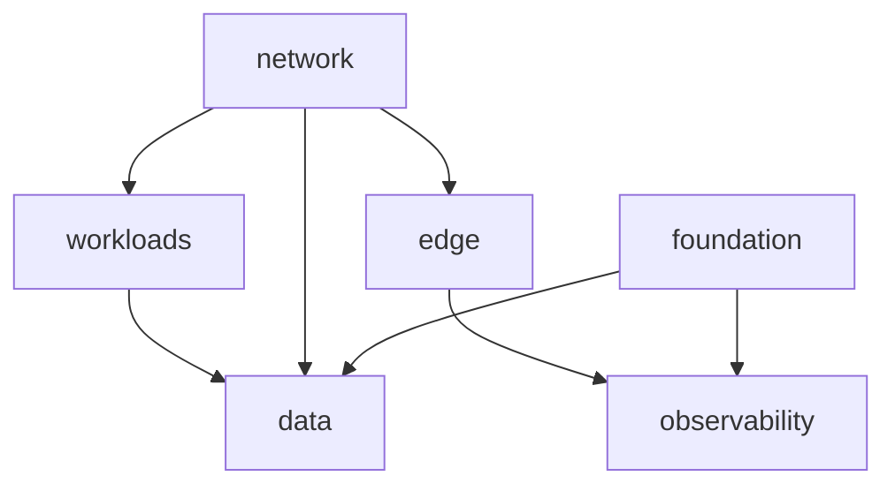

# stack/regional

Single-region **composed stack**: foundation, network, workloads, data, edge, observability, plus app→data security group rules in [sg_rules.tf](sg_rules.tf).

Deployed via Terragrunt: [live/dev/terragrunt.hcl](../../live/dev/terragrunt.hcl), [live/prod/terragrunt.hcl](../../live/prod/terragrunt.hcl).

## Usage (Terragrunt)

```bash
export TG_STATE_BUCKET=...
export TG_LOCK_TABLE=...
export TF_VAR_db_password=...
export TF_VAR_redis_auth_token=...
cd src/problem1/terraform/live/dev
terragrunt plan
```

## Requirements

Same as child modules (Terraform >= 1.16, AWS provider >= 5.100).

## Key inputs

Full list: [variables.tf](variables.tf). Secrets and sizing are set in Terragrunt, not in this module.

| Name | Description |
| --- | --- |
| `cost_center` | FinOps `CostCenter` tag |
| `db_password` | RDS master password |
| `redis_auth_token` | ElastiCache AUTH token |
| `postgres_engine_version` / `postgres_instance_class` | RDS pins |
| `redis_engine_version` / `redis_node_type` / `redis_num_cache_clusters` | Redis pins |

## Outputs

| Name | Description |
| --- | --- |
| `alb_dns_name` | Public ALB DNS |
| `audit_bucket_id` | Audit S3 bucket |
| `sns_topic_arn` | Alerts topic |
| `vpc_id` | Regional VPC |

## Module graph



## Tests

```bash
terraform init -backend=false
terraform validate
terraform test
```

Integration mock plan: [tests/regional.tftest.hcl](tests/regional.tftest.hcl).
