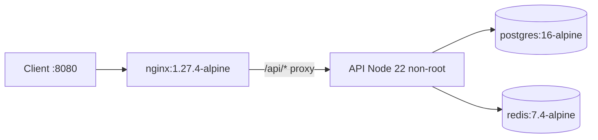

# Problem 3 — Container platform stabilization

Stack under [src/problem3](.) — NGINX → API → PostgreSQL + Redis.

## Architecture



## Symptoms

- `/` OK; `/api/users` fails or flakes after `docker compose up`.

## Root causes

| # | Issue | Fix |
| --- | --- | --- |
| 1 | NGINX `proxy_pass` port **3001**, API listens **3000** | [default.conf](nginx/conf.d/default.conf) → `http://api:3000` |
| 2 | Startup race | Healthchecks + `depends_on: condition: service_healthy` in [docker-compose.yml](docker-compose.yml) |
| 3 | `init.sql` not loaded | Mount to `/docker-entrypoint-initdb.d/` |

## Hardening

- API [Dockerfile](api/Dockerfile): multi-stage, user `10001`, HEALTHCHECK `/status`.
- Compose: `read_only`, `no-new-privileges`, memory limits; NGINX `server_tokens off`, rate limit.

Image tags align with [docs/VERSION-PINS.md](../../docs/VERSION-PINS.md) where applicable.

## Tests

| Layer | Location | CI |
| --- | --- | --- |
| API unit | [api/test/status.test.js](api/test/status.test.js) | `problem3-api-tests` in [pr-quality-gate.yml](../../.github/workflows/pr-quality-gate.yml) |
| Full stack | [tests/problem3_smoke.sh](../../tests/problem3_smoke.sh) | `problem3-compose-smoke` (Docker Compose up, `/` + `/api/users`) |

## Verify locally

```bash
cd src/problem3/api && npm ci && npm test
bash tests/problem3_smoke.sh   # from repo root — requires Docker
```

Expected smoke: HTTP 200 and JSON `"ok":true` from `/api/users`.
