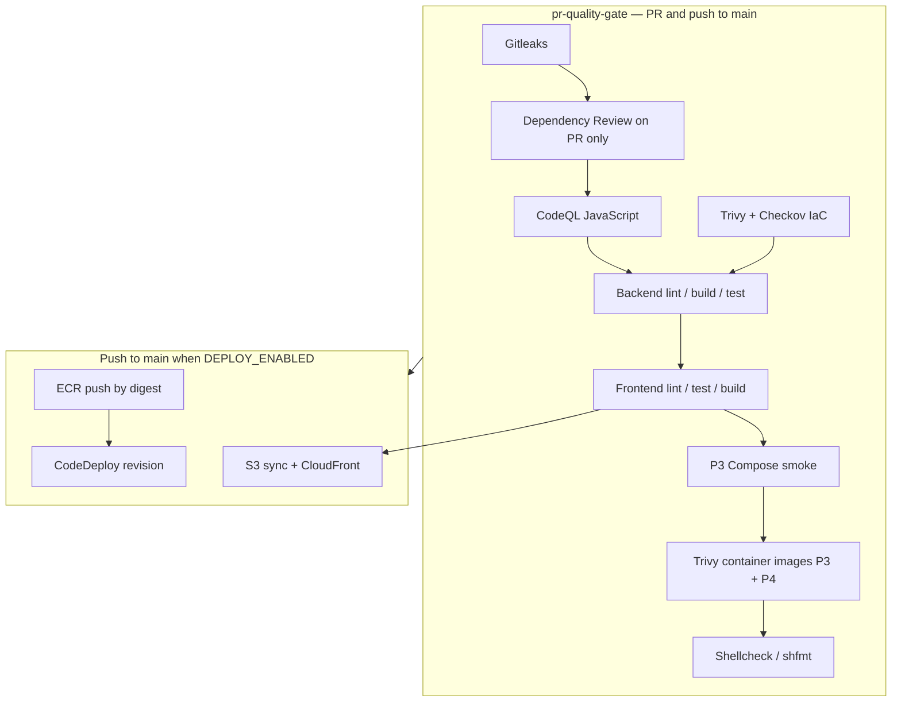

# Problem 4 — CI/CD (backend EC2, frontend S3)

Pipelines use **pinned GitHub Action SHAs**, container build, image scan on the quality gate, and deploy steps gated by `vars.DEPLOY_ENABLED` until AWS OIDC is configured.

**Monorepo:** backend and frontend live under [apps/](apps/) with workflows at the repository root ([problem4-backend-ci.yml](../../.github/workflows/problem4-backend-ci.yml), [problem4-frontend-ci.yml](../../.github/workflows/problem4-frontend-ci.yml)). The shared gate ([pr-quality-gate.yml](../../.github/workflows/pr-quality-gate.yml)) also runs Problem 1 IaC checks and Problem 3 stack tests — required **`gate`** job on pull requests (and on push to `main` / `master`).

## Applications

| App | Path | Runtime |
| --- | --- | --- |
| API | [apps/backend](apps/backend) | Node 22 LTS, [Dockerfile](apps/backend/Dockerfile) non-root, `GET /health` |
| Web | [apps/frontend](apps/frontend) | Static build → `dist/` → S3 |

Dependency pins: [docs/VERSION-PINS.md](../../docs/VERSION-PINS.md).

## Pipeline overview



| Workflow | File | Role |
| --- | --- | --- |
| Quality gate | [pr-quality-gate.yml](../../.github/workflows/pr-quality-gate.yml) | Required checks (PR + push to default branch) |
| Backend | [problem4-backend-ci.yml](../../.github/workflows/problem4-backend-ci.yml) | lint/build/test, ECR, CodeDeploy |
| Frontend | [problem4-frontend-ci.yml](../../.github/workflows/problem4-frontend-ci.yml) | lint/test/build artifact, S3 deploy |
| Terraform | [terraform-ci.yml](../../.github/workflows/terraform-ci.yml) | Extra validation when only IaC changes |

## Backend: Docker, ECR, CodeDeploy

- **CI:** `npm ci` → `npm run lint` → `npm run build` → `npm test` → Docker build → Trivy image (quality gate).
- **Production path:** OIDC → push image by **digest** to ECR → zip AppSpec + `scripts/image_uri` to S3 → CodeDeploy to EC2 ([deploy/README.md](apps/backend/deploy/README.md)).
- **Optional reference (SSM / nginx ports):** [ec2/deploy.sh](ec2/deploy.sh), [ec2/rollback.sh](ec2/rollback.sh), [scripts/ssm-backend-command.sh](scripts/ssm-backend-command.sh).

## Frontend: S3 and CloudFront

Build output: [apps/frontend/dist/](apps/frontend/dist/) (from [scripts/build.js](apps/frontend/scripts/build.js)).

Deploy order in CI:

1. Sync all objects **except** `index.html` with long-lived cache headers (immutable hashed assets when present).
2. Upload `index.html` with `Cache-Control: no-cache, no-store, must-revalidate`.
3. Invalidate CloudFront paths `/index.html` and `/` (not every hashed object).

Bucket remains private; CloudFront OAC is assumed (standard static hosting pattern).

## Local checks

Same order as CI (`lint` → `build` → `test`):

```bash
cd src/problem4/apps/backend
npm ci && npm run lint && npm run build && npm test
docker build -t platform-trading-api:local .
docker run --rm -p 3000:3000 platform-trading-api:local
curl -sf http://127.0.0.1:3000/health
```

```bash
cd src/problem4/apps/frontend
npm ci && npm run lint && npm run build && npm test
```

## Enable real AWS deploy

1. IAM OIDC trust for this repository.
2. Follow [docs/GITHUB-ACTIONS-SECRETS.md](../../docs/GITHUB-ACTIONS-SECRETS.md): environment `production` secrets (`AWS_ROLE_ARN`, `CLOUDFRONT_DISTRIBUTION_ID`), repository variables (`DEPLOY_ENABLED`, bucket/ECR names).
3. Set `DEPLOY_ENABLED=true` plus `CODEDEPLOY_*` and `CODEDEPLOY_REVISION_BUCKET`. GitHub checklist: [docs/GITHUB-REPO-SETUP.md](../../docs/GITHUB-REPO-SETUP.md).

## Deliberately out of scope

- Provisioning AWS with Terraform in this area (see Problem 1).
- Multi-instance HA behind ALB (single EC2 reference).
- Database migrations (no schema migration tool in this tree).
- Slack/PagerDuty wiring (optional — [MONITORING-SLACK.md](../../docs/MONITORING-SLACK.md)).
