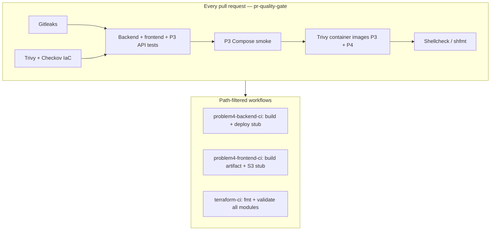
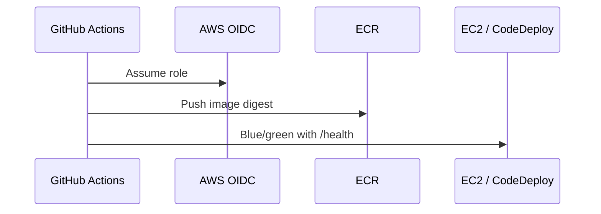

# Problem 4 — CI/CD (backend EC2, frontend S3)

Pipelines use **pinned GitHub Action SHAs**, container build, image scan on the PR gate, and mock deploy steps until AWS OIDC is configured.

The repository **PR gate** ([pr-quality-gate.yml](../../.github/workflows/pr-quality-gate.yml)) also runs Problem 1 IaC checks and Problem 3 stack tests — one monorepo, one required `gate` job before merge.

## Applications

| App | Path | Runtime |
| --- | --- | --- |
| API | [apps/backend](apps/backend) | Node 22 LTS, [Dockerfile](apps/backend/Dockerfile) non-root |
| Web | [apps/frontend](apps/frontend) | Static build → S3 |

Dependency pins: [docs/VERSION-PINS.md](../../docs/VERSION-PINS.md).

## Pipeline overview



| Workflow | File | Role |
| --- | --- | --- |
| PR gate | [pr-quality-gate.yml](../../.github/workflows/pr-quality-gate.yml) | Required checks on every PR |
| Backend | [problem4-backend-ci.yml](../../.github/workflows/problem4-backend-ci.yml) | Test, build, production deploy placeholder |
| Frontend | [problem4-frontend-ci.yml](../../.github/workflows/problem4-frontend-ci.yml) | Test, build, artifact, S3/CloudFront placeholder |
| Terraform | [terraform-ci.yml](../../.github/workflows/terraform-ci.yml) | Extra validation when only IaC changes |

## Deploy path (target)



## Local checks

```bash
cd src/problem4/apps/backend
docker build -t devopslite-trading-api:local .
docker run --rm -p 3000:3000 devopslite-trading-api:local
curl -sf http://127.0.0.1:3000/health
```

## Enable real AWS deploy

1. IAM OIDC trust for this repository.
2. Follow [docs/GITHUB-ACTIONS-SECRETS.md](../../docs/GITHUB-ACTIONS-SECRETS.md): environment `production` secrets (`AWS_ROLE_ARN`, `CLOUDFRONT_DISTRIBUTION_ID`), repository variables (`DEPLOY_ENABLED`, bucket/ECR names).
3. Set `DEPLOY_ENABLED=true` plus `CODEDEPLOY_*` and `CODEDEPLOY_REVISION_BUCKET`; one ECR build/push per release (`build-push-ecr` only — job `build` is skipped on that path). CodeDeploy revision zip includes `scripts/image_uri` for [deploy/scripts/start-api.sh](apps/backend/deploy/scripts/start-api.sh). Runtime/IAM: [apps/backend/deploy/README.md](apps/backend/deploy/README.md). Frontend: `aws s3 sync` + CloudFront invalidation.
