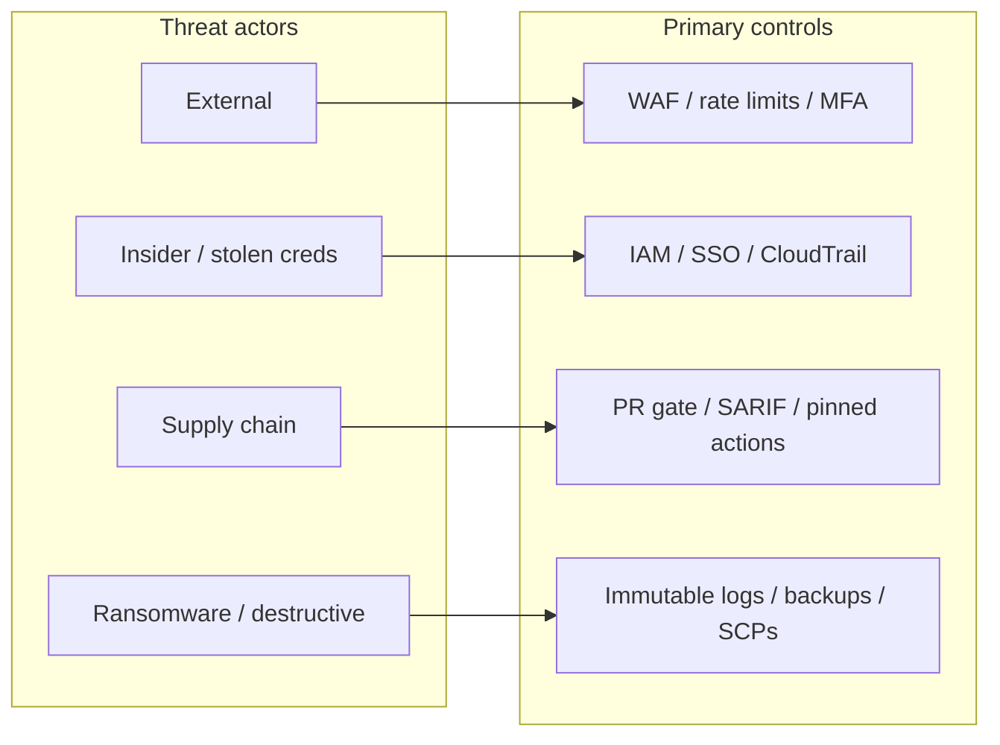
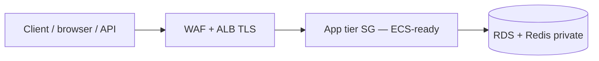
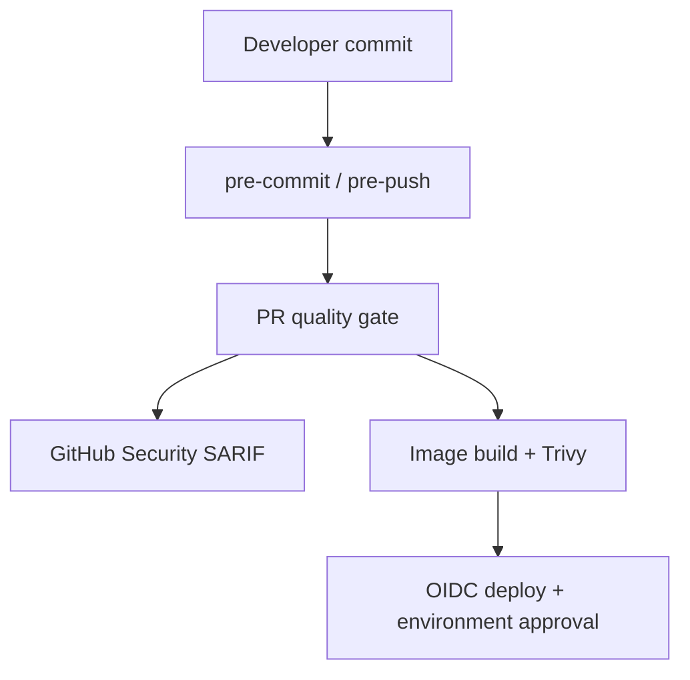
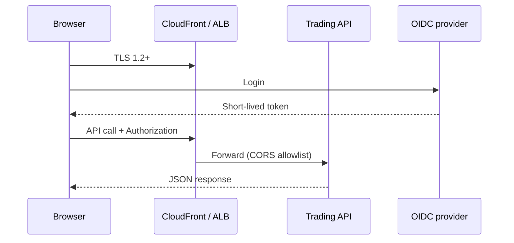
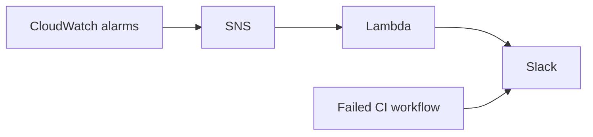

# Problem 5 — Security and resilience

This document complements [Problem 1](problem1/SOLUTION.md): controls from code through production, with evidence at each layer.

## Threat overview

| Actor | Objective | Controls |
| --- | --- | --- |
| External | API abuse, DDoS, credential stuffing | WAF, rate limits, bot control, MFA |
| Insider / compromised engineer | Exfiltration, privilege abuse | IAM Identity Center, least privilege, CloudTrail, SSM (no SSH keys) |
| Supply chain | Malicious dependency or CI artifact | Gitleaks, Trivy, Checkov, SHA-pinned Actions, image scan |
| Destructive | Encrypt or wipe data | Audit log immutability, cross-region backup, SCPs |

## Landing zone and state

- SCPs (target org): deny unapproved regions, public S3 ACLs, risky IAM patterns.
- [Foundation module](problem1/terraform/modules/foundation/): KMS rotation, CloudTrail validation, GuardDuty.
- Terraform state: S3 encryption, versioning, least-privilege IAM for automation roles.

## Network and identity

- Workloads without public IPs; **security group to security group** ([workloads](problem1/terraform/modules/workloads/) → [data](problem1/terraform/modules/data/)); app egress rules in [sg_rules.tf](problem1/terraform/modules/stack/regional/sg_rules.tf).
- **Implemented today:** app-tier security group and RDS/Redis in private subnets. **Target:** ECS task IAM roles per service (no long-lived keys in application code).
- Human access: SSO + MFA; break-glass account monitored.

## Shift-left pipeline

| Layer | Control | Evidence |
| --- | --- | --- |
| Local | secrets, fmt, shellcheck | Hooks — [REPO-GUARDRAILS.md](../../docs/REPO-GUARDRAILS.md) |
| PR | Gitleaks, Trivy, Checkov, tests | SARIF categories in GitHub |
| Build | Container scan | `trivy-image` |
| Deploy | OIDC, digest pin | GitHub `environment: production` |

Trivy and Checkov together: [docs/SCANNING-TOOLS.md](../../docs/SCANNING-TOOLS.md).

## Application and edge

- TLS at ALB/CloudFront; HSTS at edge.
- JWT/OIDC; short TTL; refresh via HttpOnly cookie or BFF where used.
- CORS allowlist: [backend](../problem4/apps/backend/src/index.js) (`CORS_ORIGINS`).
- Headers: Helmet; NGINX `server_tokens off`, rate limit ([Problem 3](../problem3/nginx/)).

Details: [FRONTEND-BACKEND-SECURITY.md](../../docs/FRONTEND-BACKEND-SECURITY.md).

## Detection and response

- Runtime: [observability module](problem1/terraform/modules/observability/) (ALB 5xx, RDS CPU, optional Slack).
- CI: [slack-ci-alerts.yml](../../.github/workflows/slack-ci-alerts.yml).
- Runbooks: ALB errors, RDS pressure, GuardDuty severity ≥ HIGH.

## Audit

- CloudTrail to encrypted audit bucket; application audit stream to immutable storage (MSK → S3 Object Lock — target).
- Infrastructure and deploy changes traceable to PR and commit.

## Accepted residual risk

| Item | Note |
| --- | --- |
| Service mesh mTLS | Deferred until service count justifies App Mesh cost |
| HSM for custodial keys | Required before on-platform customer crypto |
| Formal red team | Schedule before general availability |

## Verification

- [ ] No open CRITICAL–LOW on Trivy/Checkov for operational paths on `main`
- [ ] Branch protection requires `pr-quality-gate`
- [ ] Synthetic alarm and failed CI reach Slack
- [ ] Tabletop: compromised task role scoped to one service
